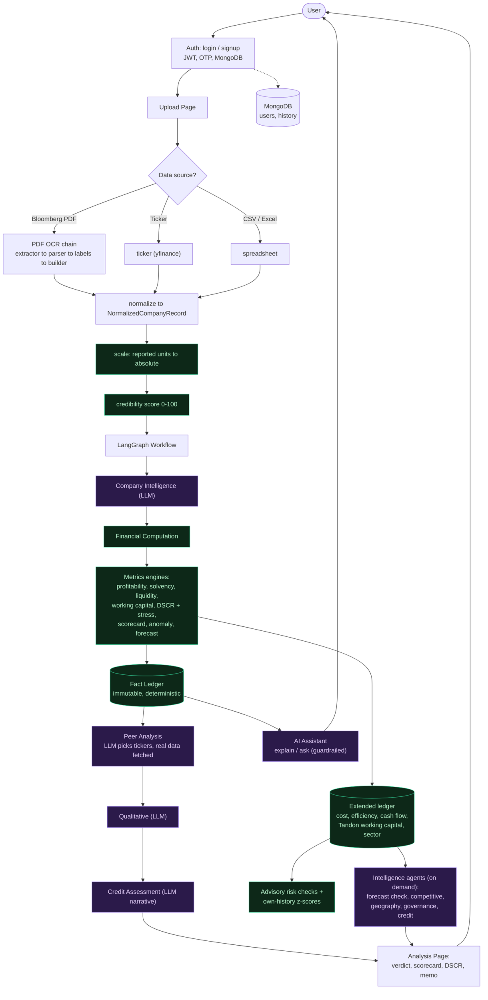

# FinVeritas — Architecture

**The one rule:** Python computes every number; the AI only narrates. Ratios, DSCR, the
credit grade and default-probability bands are all deterministic. The LLM classifies the
company, picks peer tickers (whose data is then *fetched*, not guessed), and turns the
computed facts into plain English. It can never invent or change a figure.

## System flow

**Green = deterministic (Python).  Purple = AI (explains only).** The intelligence agents
(purple) each run a deterministic Python core first and only then ask the model to narrate it.

## The Fact Ledger — the contract

The **Fact Ledger** is the boundary between the two layers. The metrics engines compute it
in pure Python; once built, its numbers are frozen. Every downstream consumer — the peer
comparison, the credit narrative, the AI assistant, the memo — can only *read* the ledger,
never recompute or alter a value. This is what makes the whole system auditable: every
figure has a formula and a source, and no LLM sits between the data and the number.

## Two ledgers

The core Fact Ledger drives the credit verdict: its risk signals feed the risk dashboard, and its entries are
what the credit-assessment and assistant prompts are built from. The **extended ledger** (same schema, no
overlapping metric names) holds the additional metrics from the DeterminX integration. It is kept apart on purpose:
its metrics carry no risk signal, and the advisory risk checks built on it never change the grade or the overall risk
level. Otherwise adding metrics would silently move existing grades and bloat the model's context.

Every metric states its availability: `VALID`, `ESTIMATED` (a disclosed assumption), `INSUFFICIENT_DATA`,
`REQUIRES_ADDITIONAL_DOCUMENT` or `REQUIRES_EXTERNAL_DATA`, so a gap says why it is a gap. Estimated MPBF is always
`ESTIMATED` and Drawing Power is never given a number. See **[KT_INTEGRATION.md](KT_INTEGRATION.md)**.

## Layers

| Layer | Package | Role |
|-------|---------|------|
| **Auth** | `finveritas/auth` | Login/signup, JWT sessions, OTP, MongoDB users |
| **Ingestion** | `finveritas/ingestion` (+ `pdf/`) | PDF/ticker/CSV → normalized record → unit-scale → credibility |
| **Deterministic** | `finveritas/analysis/metrics` | All numbers: profitability, solvency, liquidity, working-capital, DSCR + stress, scorecard, anomaly (incl. own-history z-scores), forecast (incl. assumption validation) |
| **Extended metrics** | `finveritas/analysis/metrics/extended` | Cost, efficiency, ROIC, cash flow, growth, trends, Tandon working capital, sector metrics, advisory risk checks. Separate ledger |
| **Intelligence** | `finveritas/intelligence` | On-demand agents (forecast check, competitive, credit, geography, governance) and the external-data layer. Deterministic core, then narration |
| **Agentic (AI)** | `finveritas/analysis/workflow`, `assistant` | Orchestration + narration + guardrailed Q&A — never computes |
| **Presentation** | `web/` (React) served by `api/` (FastAPI) | The results screens. `finveritas/analysis/page` is the older Streamlit version |
| **Shared** | `finveritas/shared` | Schema (the models), formatting, currency, meanings |

See **[STRUCTURE.md](STRUCTURE.md)** for the full file tree and execution order, and
**[VERSION_HISTORY.md](VERSION_HISTORY.md)** for how the system evolved (V1 → V2 → V3).
